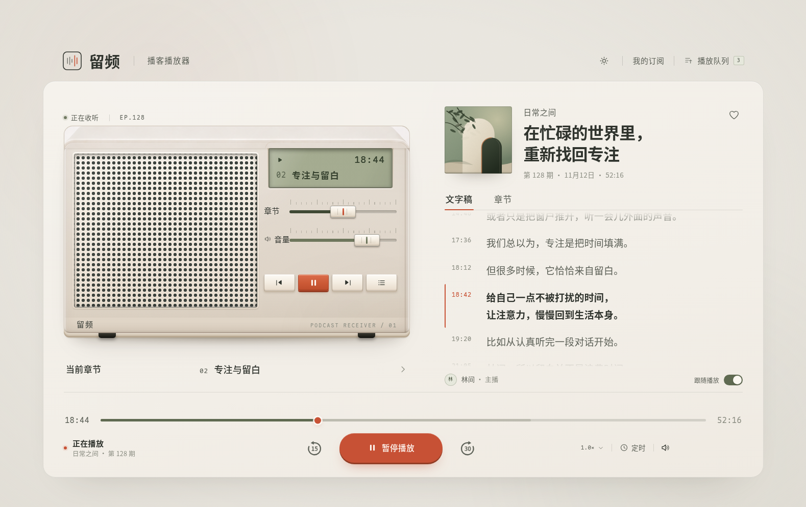
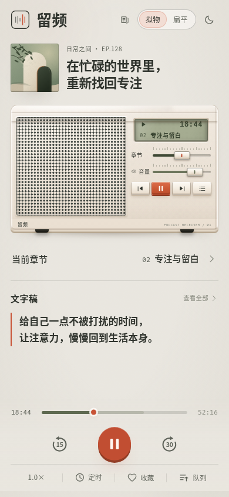
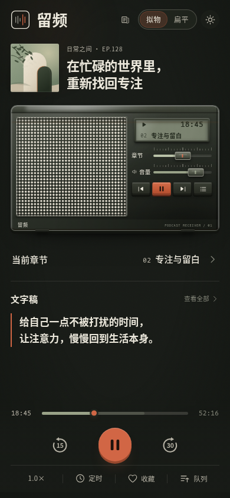
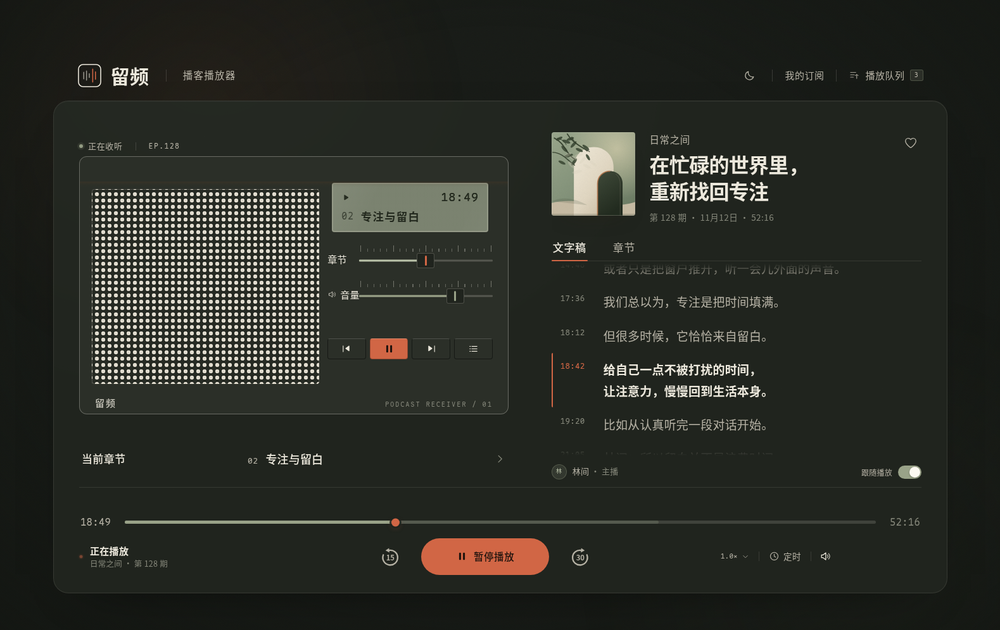

# 留频 · Stay Tuned

[](LICENSE) [](https://github.com/xzl01/stay-tuned) [](https://xzl01.github.io/stay-tuned/)

一档可以**订阅 RSS 播客**、也可以**调谐 M3U 网络电台**的播放器。PC 与移动端各有一套独立编排的界面，支持拟物 / 扁平两种质感和浅色 / 深色两种主题。

## 设计依据

后续界面工作从 [设计资料入口](docs/design/README.md) 与 [已确认设计约束](docs/design/constraints.md) 继续。最新方向为**章节与音量双推杆、小型反射式液晶屏**，可查看 [桌面端参考稿](docs/design/references/current/desktop-light-skeuomorphic.png) 和 [手机端参考稿](docs/design/references/current/mobile-light-skeuomorphic.png)。设计资料与下方现有实现截图分开保存；旧的旋钮、大屏和音量读数方案已被后续约束取代。



<p align="center">
  
  &nbsp;&nbsp;&nbsp;
  
</p>

---

## 功能

### 播客

- **RSS / Atom 订阅**：粘贴任意公开 RSS 地址即可解析节目、封面、单集、时长和 Show Notes。
- **订阅重命名**：导入的 RSS 订阅可以直接改名；自定义名称保存在本机，刷新订阅后不会被 feed 原标题覆盖。
- **订阅更新**：打开「我的订阅」时会自动尝试刷新超过 30 分钟未同步的订阅（每次最多 3 档），也可以点节目旁的刷新按钮手动更新；更新失败保留旧数据。
- **播客发现**：通过 Apple Podcasts 目录搜索节目，直接订阅对应的 RSS；把 RSS 链接直接粘进搜索框也会识别为「直接订阅」，不用先找「添加 RSS」。
- **单集播放**：断点续听（每个单集独立保存进度）、15 秒后退 / 30 秒前进、倍速、音量推杆、静音。
- **单集库**：展开节目查看完整单集列表，支持最新 / 最早排序，显示已听进度、已听完状态和日期信息。
- **播放队列**：顺序播放、加入队列、上下移动、移除、清空；一期结束后自动接上下一段。
- **章节与文字稿**：支持 Podcasting 2.0 的 `<podcast:chapters>` 和 `<podcast:transcript>`（VTT / SRT / JSON / 纯文本），演示版另带示例数据；拖动机身上的章节推杆可预览章节，松手跳转，文字稿中的句子也可直接点击。普通 RSS 的节目简介作为「简介」标签展示。
- **睡眠定时**：15 / 30 / 60 分钟，或「本集结束后暂停」。
- **收藏**：「我的订阅」中有独立的收藏标签页，收藏的播客单集和电台可以在这里统一播放或移除。
- **Media Session**：桌面媒体键、锁屏控制、系统播放/暂停/上一段/下一段。
- **离线缓存**：可手动缓存单集，也可开启「发现新播客自动下载」和「在听的播客自动缓存」；缓存完成后下次播放直接从本机读取。支持逐条删除、清空全部、查看占用空间与下载进度。
- **跟随播放**：文字稿随声音自动滚动，可关闭。

### 电台

- **M3U 导入**：支持扩展 M3U（`group-title`、`tvg-logo`、`tvg-name`）、远程 URL 和**本地 `.m3u` 文件**。导入时可以给整份播放列表命名；如果列表只有一条流，名称会直接用作电台名，不再多套一层分组。之后在「我的电台」中可重命名播放列表，也可以点电台旁的铅笔单独改名；同样的位置还能上传本地图片或粘贴图片地址，自定义电台封面。此前已导入、仍带原始 M3U 来源的旧数据会自动归组；单条流的旧分组会自动收起，第一次打开后同样可以改名。
- **直接流地址**：自动识别 Icecast / SHOUTcast 等直接音频流，避免无限缓冲。
- **HLS**：通过 `hls.js` 播放 `.m3u8`；服务端会把 manifest 和分片重写为同源代理，绕开很多电台不返回 CORS 头的问题。
- **电台搜索**：基于 Radio Browser 目录搜索全球网络电台。
- **编辑精选**：首屏附带几个长期可用的公共电台（SomaFM、FIP、KEXP）。
- **实时调谐**：电台模式下采用 LIVE 读数和「不可拖动进度」的界面语义；桌面电台波形、手机直播卡片和底部实时信号线都由 Web Audio 分析当前音频驱动，是真实频谱。
- **频谱回退**：浏览器不支持 Web Audio、或音频源无法进入分析器时，自动保留原来的装饰性波形动画，不影响播放。

### 界面

- **两套 UI**：`≤1023px` 使用移动/平板编排（竖排、底部粘性传输栏、全屏底部抽屉）；更宽时使用桌面编排（横向收音机 + 节目侧栏 + 加宽控制条）。
- **拟物 / 扁平**：拟物模式保留奶油色 / 炭灰机身、精密孔阵、微凹推杆轨道、机身投影与实体按键；扁平模式沿用同一套小 LCD、双推杆和按键语义，以纯色与简洁线条表达。桌面端外观切换收在右上角的「外观设置」菜单里，手机端保留直给的拟物 / 扁平与明暗入口。
- **音量只由推杆位置表示**：机身和屏幕都不显示音量百分比、数字或额外电平条；章节推杆与底部连续播放进度条分工明确。
- **浅色 / 深色**：独立配色，随阅读环境切换。
- **纯本地**：订阅、队列、收藏、进度、主题均存在浏览器 `localStorage`，没有账号和后端数据库。真实章节 / 文字稿按需读取并只保存在当前会话内存中。
- **可安装 PWA**：生产构建包含 manifest 与离线 app shell service worker，可添加到桌面 / 主屏幕；界面可离线打开，RSS 与电台播放需要联网。

---

## 收音机 3D 彩蛋

在**拟物模式**下长按播放键 **5 秒**，Three.js 模型会在原位置替换收音机。桌面与手机的收音机播放键、下方主播放键均支持。首次进入页面不加载 Three.js、模型和专用样式；触发后才下载独立代码块。

按住半秒后显示提示和长按进度条。按钮内移动不会打断计时；明显移出按钮、松手或切到后台会取消。触控播放键会捕获当前手势，避免轻微移动被页面滚动打断。

模型支持拖动旋转、滚轮 / 双指缩放、查看背面、自动环绕与重置。实体推杆、按键和小屏幕连接当前播放、音量、章节及队列；原页面其他区域仍可操作。模型下方的“操作”面板提供键盘可用的滑块，不显示音量数字。

点击“退出 3D”或按 `Esc` 恢复原外观，释放画布、动画循环、事件监听和 GPU 资源；切到扁平模式同样退出。播放状态和进度保持连续。刷新页面后回到默认外观，再次长按才会启用。

## 快速开始

要求 **Node.js ≥ 20.19**（建议 22）。

```bash
npm ci
npm run dev
```

- 前端：<http://localhost:5173>
- API：<http://localhost:8787>

`npm run dev` 会同时启动 Node API（负责 RSS / M3U / 音频代理）和 Vite 前端。手机与电脑在同一局域网时，可以直接访问 `http://<电脑局域网 IP>:5173` 查看移动端 UI。

### 生产模式

```bash
npm run build
npm start
```

打开 <http://localhost:8787>。Node 服务会同时托管 `dist/` 静态文件与 `/api/*` 接口。

可用环境变量：

| 变量 | 默认值 | 说明 |
| --- | --- | --- |
| `PORT` | `8787` | Node 服务端口 |
| `HOST` | `0.0.0.0` | 监听地址；只想本机访问可设为 `127.0.0.1` |
| `CORS_ORIGINS` | 空（允许任意来源） | 逗号分隔的允许来源，例如 `https://app.example.com`；留空时返回 `*` |
| `STAY_TUNED_ALLOW_PRIVATE_HOSTS` | 关闭 | 设为 `1` 后允许代理访问局域网 / 本机地址（例如自建局域网电台）。云元数据地址始终被拒绝 |

#### 代理安全边界

`/api/feed`、`/api/playlist`、`/api/audio`、`/api/hls`、`/api/image`、`/api/chapters`、`/api/transcript` 都会用客户端传来的 URL 发起请求，因此 Node 服务默认把它当作**不可信的开放代理**处理：

- 拒绝 `localhost`、`.local`、`.internal`、单段主机名、环回 / 私网 / 链路本地 / CGNAT / 保留网段和 IPv6 私有地址，以及 `169.254.169.254`、`fd00:ec2::254` 等云元数据地址；
- 域名会先解析再校验，避免用公网域名指向内网（DNS rebinding 的常见形式）；
- 重定向由服务端自己逐跳跟随，每一跳都重新做上述校验，禁止跨协议跳转；
- 文本类响应超过 48 MB、封面超过 6 MB、HLS 清单超过 4 MB 时中止读取。

局域网电台需要显式打开 `STAY_TUNED_ALLOW_PRIVATE_HOSTS=1`；即使打开，云元数据地址仍然拒绝。Android 应用直接由手机发请求，不受这一层限制。

> 仍建议把服务放在反向代理或内网之后，并为公网部署加上访问控制。默认 `HOST=0.0.0.0` 与 `CORS_ORIGINS` 留空是为了本地局域网调试方便，不适合直接暴露到公网。

### 离线缓存

在「我的订阅」单集行右侧点下载图标即可手动缓存该期；再次点击删除。也可以进入「设置 → 离线缓存」统一管理：

- 打开 **发现新播客自动下载**：订阅或刷新后，只缓存此后新出现的单集（每档最多最新 3 期），开启时不会回填整库；
- 打开 **在听的播客自动缓存**：切到某期节目时自动下载；
- 查看缓存数量、总占用与下载进度，逐条删除或清空全部。

实现按平台分流：Web / Electron 把音频 Blob 存进 IndexedDB，播放时用 `blob:` URL；Android 用 Capacitor Filesystem 下载到应用私有目录，交给 ExoPlayer 读本地文件。索引只存 localStorage，不进入订阅备份。直播电台、HLS 串流和 GitHub Pages 静态演示版不缓存；下载按队列串行，缓存完成不会打断正在播放的声音，本地源在下次播放该集时生效。自动缓存失败是静默的，不弹通知。

### Android 应用

仓库内置 [Capacitor](https://capacitorjs.com/) 工程（`android/`），可以直接构建 APK：

```bash
npm ci
npm run android:sync   # 构建前端并同步到 android 工程
npm run android:apk    # 产出 android/app/build/outputs/apk/debug/app-debug.apk
```

本地构建需要 **Node.js 22**、**JDK 21**、**Android SDK（compileSdk 36 / build-tools 36）**。如果不希望配置本地环境，可以走 GitHub Actions：

| 方式 | 结果 |
| --- | --- |
| Actions → **Build Android APK** → Run workflow | 下载 `stay-tuned-apk` artifact（debug + release） |
| 推送 `v*` 标签（如 `git tag v1.0.0 && git push origin v1.0.0`） | 自动构建并附到 GitHub Release |

没有配置签名时，**debug APK 可以直接安装到手机**（使用调试签名）；`release-unsigned.apk` 不能直接安装，仅用于随后用你自己的密钥签名。

**签名**：`release` 构建默认产出未签名的 `app-release-unsigned.apk`。要生成可安装的正式包，在仓库 Secrets 中配置：

| Secret | 说明 |
| --- | --- |
| `ANDROID_KEYSTORE_BASE64` | keystore 文件的 base64（`base64 -w0 release.keystore`） |
| `ANDROID_KEYSTORE_PASSWORD` | keystore 密码 |
| `ANDROID_KEY_ALIAS` | 密钥别名 |
| `ANDROID_KEY_PASSWORD` | 密钥密码 |

配置后 workflow 会自动签名 `app-release.apk`；缺少这些 Secrets 时仍会构建未签名包，不会失败。

> 本仓库的四个签名 Secrets 已配置，`v*` 标签产物中的 `release.apk` 是正式签名包。签名密钥（JKS / RSA 4096 / 30 年有效期）由维护者离线保管：**密钥一旦丢失，已发布的应用将无法再更新**，请自行备份，且不要提交进仓库（`.gitignore` 已屏蔽 `*.jks`、`*.keystore`、`*.p12`）。

**内置解析引擎**：APK 里打包了完整的解析层，`server/feed.mjs`、`playlist.mjs`、`extras.mjs`、`catalog.mjs` 等纯 ESM 模块被前端直接复用，网络请求通过 CapacitorHttp 走原生通道，因此**不需要任何服务端**：

| 能力 | 是否内置 |
| --- | --- |
| RSS / Atom 订阅与刷新 | ✅ |
| 播客搜索（Apple Podcasts） | ✅ |
| 电台搜索（Radio Browser） | ✅ |
| M3U / 本地 .m3u 文件导入 | ✅ |
| HLS 串流 | ✅ 交给 Android WebView 原生播放 |
| Podcasting 2.0 章节与文字稿 | ✅ |
| 封面 / 音频 | ✅ 由手机直接加载 |
| 实时频谱 | ⚠️ Android 上为装饰动画（见下） |

浏览器端仍然走 Node API（公共订阅源不返回 CORS 头）。如果想把手机的解析交给远端，可在「我的订阅」底部填一个服务端地址：填了之后会切回远程代理模式（音频也经代理，频谱因此始终可用）。

### 原生播放（Android）

APK 使用 **ExoPlayer** 播放，WebView 只负责界面：

- 音频解码、缓冲、HLS 全部在原生侧完成，不再依赖 WebView 的 `<audio>`，也不受 CORS 限制
- 支持 `.m3u8`（HLS）、MP3 / M4A 直链与直播流；`setWakeMode` 保持息屏时的网络与 CPU，后台不断流
- UI 通过 `nativeState` 事件按秒同步进度；应用不可见时停止回传，仅保留服务内部计时
- 媒体会话每 15 秒才校正一次 `PlaybackState`（系统自行插值），避免每秒唤醒 SystemUI
- 播放进度每 30 秒落盘，暂停/切歌/退出时立即写入

### 后台播放与耗电

- 媒体会话不再按固定间隔重建：只有标题、封面或播放状态变化时才更新通知与 `MediaMetadata`，其余更新只刷新 `PlaybackState`。
- 进度校准自适应：屏幕亮着时 15 秒一次，息屏 / 后台 60 秒一次；切歌、暂停、拖动进度时立即同步。息屏播放的媒体推送频率约为 **1 次/分钟**（旧实现为 12 次/分钟）。
- 播放进度渲染节流：`timeupdate` 从约 4 次/秒降到可见时 1 次/秒，息屏时不再更新 UI 状态。
- 进度与曲库分键存储：播放进度写入独立的 `stay-tuned:positions`，播放时不再重复序列化整个曲库（实测 22 秒播放的写入量从 26 KB 降到 6.5 KB，且随曲库规模线性受益）。
- 息屏时暂停全部装饰动画，避免锁屏状态下继续占用 GPU/CPU。
- Android 由 ExoPlayer 承担解码与输出，WebView 不持有音频元素，后台只剩原生播放线程。

### 小米妙享背屏（兼容媒体卡片）

小米 17 Pro / Pro Max 的「妙享背屏」是 HyperOS 管理的物理副屏；截至 2026-11 未找到普通第三方 APK 可直接自绘背屏 UI 的公开 SDK。官方公开的 Flip 外屏 Activity 适配（`miui.fliphome.default` / `miui.supportFlipFullScreen`）不等于 17 Pro 背屏绘权，社区自绘方案依赖 Shizuku、root 或系统模板替换，不适合作为商店版功能。

因此 Android 版采用**兼容优先**方案：在检测到 `MiuiMultiDisplayTypeInfo.isRearDevice()` 的机型上，把 `MediaSession` 与媒体通知的封面替换成运行时绘制的「留频收音机」位图；小 LCD 内显示播放 / 暂停、时间或 `LIVE`、当前章节，章节与音量推杆保持设计约束中的语义，动态文字不印在机身上。拟物 / 扁平与亮色 / 深色随主应用偏好切换，刷新按 5 秒节流，普通 Android 设备仍显示真实节目 / 电台封面。

限制：系统背屏音乐卡片是否把本应用纳入显示由 HyperOS 版本、用户开关和可能的音乐白名单决定；应用无法强制把卡片添加到背屏，也无法控制小米系统模板的裁切与排版。最终效果需要小米 17 Pro / Pro Max 真机验证。

### 桌面小组件与系统媒体控制

APK 内置原生媒体会话与桌面小组件：

- **主屏小组件**（长按桌面 → 小组件 → 留频）：显示当前节目/电台与播放状态，提供上一集 / 播放暂停 / 下一集三个按钮；应用在前台可直接控制，不在前台时会拉起应用后执行。
- **媒体通知与系统面板**：播放时出现可拖动的媒体通知（`category=transport`），锁屏、通知栏、耳机按键、系统媒体面板都能控制播放；HyperOS 的媒体焦点区域（灵动岛式展示）读取的也是这个会话。
- **订阅备份**：「我的订阅」底部 → 备份 / 同步，可把订阅、收藏、进度导出为 JSON 文件（安卓写入 Documents 并拉起分享），在另一台设备用「合并」或「替换」导入。
- **线性马达触感**：双推杆刻度、实体按键、主播放键、抽屉开合、成功 / 失败提示、5 秒长按彩蛋和 3D 开机都有触感。离散按键走系统 `HapticFeedbackConstants`（由系统 / 厂商调音），推杆、拨杆、卡榫与提示走自定义波形并使用 `USAGE_TOUCH`，因此会跟随系统「触感反馈」总开关与强度；扁平外观整体降一档。开关统一收在「设置 → 外观 → 触感反馈」里（有马达的设备才显示），手机顶栏和桌面端「外观设置」菜单不再单独放这个开关。实现与真机测量见 [docs/haptics.md](docs/haptics.md)。

调试签名已固定为仓库内的 `android/keystore/debug.keystore`（密码 `staytuned`），本地构建与 CI 产物可以互相覆盖安装，不会再出现签名冲突。

### 鸿蒙应用（HarmonyOS）

仓库内置 ArkTS 工程（`harmony/`），界面、播放与状态复用同一套 Vite 产物，原生侧只负责 ArkWeb 容器：

```bash
npm ci
npm run harmony:sync   # 构建前端并以相对路径写入 harmony/entry/src/main/resources/rawfile/www
npm run harmony:hap    # 产出 harmony/entry/build/default/outputs/default/entry-default-unsigned.hap
```

构建需要 **JDK 17+** 与 **OpenHarmony SDK（API 20）**，并设置 `OHOS_BASE_SDK_HOME`；hvigor 会在首次运行时自动装进 `.harmony-tools/`，不依赖 DevEco Studio。完整步骤、SDK 目录分层要求与已知限制见 [docs/harmony.md](docs/harmony.md)。

当前产物为**未签名 HAP**，可验证构建但不能直接安装；签名需在 DevEco Studio 里生成调试证书后写回 `harmony/build-profile.json5`。鸿蒙端复用同一套解析模块：ArkTS 侧通过 `registerJavaScriptProxy` 暴露 `StayTunedHttp` 网络桥，页面把它接到既有的 `setFetchTransport`，因此 RSS / 搜索 / M3U 与安卓一样直连，不需要服务端。

鸿蒙端与安卓的能力对应关系：

| 能力 | 鸿蒙实现 |
| --- | --- |
| 免服务端解析 | `StayTunedHttp`（`@kit.NetworkKit`） |
| 本地文件导入 / 备份导出 | `onShowFileSelector` + `StayTunedFiles`（保存选择器） |
| 后台播放 | `KEEP_BACKGROUND_RUNNING` + AUDIO_PLAYBACK 长时任务 |
| 锁屏 / 耳机控制、封面 | `AVSession`（`mediaImage`） |
| 触感反馈 | `StayTunedHaptics`（`@kit.SensorServiceKit`，复用安卓 cue 表） |
| 边到边与系统栏配色 | `setWindowLayoutFullScreen` + `StayTunedChrome` |
| 桌面服务卡片 | `EntryFormAbility` + `StayTunedCard`（含播放/暂停按钮） |
| 外链与下载 | `onLoadIntercept` / `onDownloadStart` 交给系统浏览器 |
| WebView 崩溃恢复 | `onRenderExited` 自动重载 |

### 桌面应用（Windows / macOS / Linux）

仓库内置 Electron 桌面端打包配置，用户无需单独安装 Node.js 或启动服务：应用内嵌 Express 服务，固定监听 `127.0.0.1:18787`，同时提供完整 RSS / M3U / HLS 代理能力。订阅、进度与主题仍保存在本机 localStorage；桌面端不注册 service worker，避免缓存与内置服务不同步。

Electron 45 上游已移除 Windows ia32 与 Linux armv7l 二进制，因此当前架构矩阵为 **x64、arm64、macOS universal**。

| 平台 | 产物 | 架构 | 构建 runner |
| --- | --- | --- | --- |
| Windows | NSIS 安装包、portable exe | x64、arm64 | `windows-latest` |
| macOS | dmg、zip | x64、arm64、universal | `macos-latest` |
| Linux | AppImage、deb、rpm、tar.gz | x64、arm64 | `ubuntu-latest` / `ubuntu-24.04-arm` |

本地构建（macOS 可原生打出全部 macOS 架构；其他平台建议交给 CI）：

```bash
npm ci
npm run desktop:mac       # macOS: dmg + zip，x64 / arm64 / universal
npm run desktop:win       # Windows: 需要 Wine 或 Windows runner
npm run desktop:linux     # Linux: 需要 rpm / fpm 工具链或 Linux runner
npm run desktop:dev       # 开发调试：构建前端并直接启动 Electron
```

脚本会先执行 `npm run build` 与 `npm run desktop:icons`（用 Python Pillow + macOS `iconutil` 生成 ico / icns / PNG 图标），再调用 `electron-builder`。产物统一输出到 `desktop-dist/`，与 Vite 的 `dist/` 分离。`package.json` 中的 `allowScripts` 仅供 npm 12 批准 Electron 与 `electron-winstaller` 的安装脚本；旧版 npm 会忽略该字段，CI 也会自动检测命令是否存在。

GitHub Actions：

| 方式 | 结果 |
| --- | --- |
| Actions → **Build desktop packages** → Run workflow | 下载各平台 artifact |
| 推送 `v*` 标签 | 自动构建全部平台并附到 GitHub Release（与 Android APK 工作流并行） |

本地 `desktop:*` 脚本会自动对 macOS arm64 / universal 包做 ad-hoc 签名（通过 `STAY_TUNED_ADHOC_SIGN=1`），使未经 Developer ID 签名的包仍能启动；CI 配置了真实证书时该 hook 不会覆盖正式签名。未经公证的包首次打开可能需要右键 → 打开或在系统设置中允许，Windows SmartScreen 可能提示风险。生产签名可在仓库 Secrets 配置：

| Secret | 说明 |
| --- | --- |
| `MAC_CSC_LINK` / `MAC_CSC_KEY_PASSWORD` | macOS Developer ID 证书（base64 `.p12`）与密码 |
| `APPLE_API_KEY` / `APPLE_API_KEY_ID` / `APPLE_API_ISSUER` / `APPLE_TEAM_ID` | Apple 公证 API 凭据 |
| `WIN_CSC_LINK` / `WIN_CSC_KEY_PASSWORD` | Windows 代码签名证书与密码 |

`electron/main.mjs` 使用单实例锁、固定回环端口与受限 CORS；若 `18787` 被占用，可通过 `STAY_TUNED_DESKTOP_PORT` 指定另一个固定端口（不要使用随机端口，否则 localStorage 的 origin 会变化）。`server/index.mjs` 已导出 `startServer()` 供桌面端嵌入，原来的 `npm start` 独立服务行为不变。

### GitHub Pages 静态演示

仓库包含 [`.github/workflows/pages.yml`](.github/workflows/pages.yml)，推送到 `main` 后会自动构建并部署到：

**<https://xzl01.github.io/stay-tuned/>**

GitHub Pages 只能托管静态文件，因此该部署是**静态演示版**：

- 内置示例播客、章节、文字稿和示例音频可以播放
- 示例电台的直链音频可以尝试直接播放；HLS/跨域代理不保证可用
- RSS 订阅、播客/电台搜索、M3U 导入、刷新、远程章节/文字稿等依赖 Node API 的功能会提示静态演示限制
- 所有数据仍只保存在浏览器本地

完整功能请在本机执行 `npm run dev` 或部署 Node 服务。Pages 构建使用 `VITE_BASE=/stay-tuned/` 和 `VITE_STATIC_DEMO=1`，并已适配子路径、PWA manifest 与 service worker scope。

### 测试

```bash
npm test          # 服务端 RSS / M3U / HLS 解析单元测试
npm run license:check  # 依赖许可证合规检查
npm run build     # TypeScript 类型检查 + 生产构建
```

---

## 使用指南

### 订阅一档播客

1. 点击右上角「我的订阅」。
2. 点击「添加 RSS」，粘贴 RSS 地址；或直接把 RSS 链接粘进搜索框，在「直接订阅这个 RSS」卡片里点订阅；也可以搜索播客名称后订阅。
3. 点开节目 -> 点单集即开始播放。播放器会记住你听到的位置。

### 导入 M3U 电台

1. 「我的订阅」-> 切到「电台」。
2. 点「导入 M3U」，粘贴 `.m3u` 链接，或点「从本地 .m3u 文件导入」。
3. 播放列表里的电台会加入你的电台列表；也可以只点「试听」立即收听。

本地示例播放列表：[`public/demo/stations.m3u`](public/demo/stations.m3u)。

### 设置

顶栏右侧的推杆图标打开**设置**，把低频项集中在一处，「我的订阅」底部只保留一个入口。设置分为五组：

| 分组 | 内容 |
| --- | --- |
| 外观 | 质感（拟物 / 扁平）、主题（跟随系统 / 亮色 / 暗色）、触感反馈（有马达时） |
| 播放 | 文字稿跟随播放 |
| 离线缓存 | 已用空间与条数、音频缓存管理、发现新播客自动下载、在听的播客自动缓存 |
| 数据 | 订阅备份 / 同步（打开备份面板）、解析引擎（打开服务地址面板） |
| 关于 | 版本、运行环境、下载更新（跳转 GitHub Releases）、开源许可 |

顶栏只保留「质感」（拟物 / 扁平）这一个快速开关，因为它一眼就能看出差别；**主题与触感反馈只在设置里**，避免播放界面堆太多参数。缓存体积这类不需要频繁查看的信息同样只在设置页显示。桌面端仍可用 `D` 键快速切换浅色 / 深色。

### 快捷键（桌面）

| 按键 | 行为 |
| --- | --- |
| `Space` | 播放 / 暂停 |
| `←` / `→` | 后退 15 秒 / 前进 30 秒 |
| `M` | 静音 / 取消静音 |
| `L` | 打开我的订阅 |
| `Q` | 打开播放队列 |
| `D` | 切换浅色 / 深色 |
| `Esc` | 关闭抽屉 |

---

## 技术结构

```
.
├── electron/              Electron 主进程 + preload（桌面应用）
├── build/                 桌面端图标与 Ubuntu AppArmor 配置
├── electron-builder.yml   多平台 / 多架构打包配置
├── server/
│   ├── index.mjs          Express API + 生产静态托管（可被桌面端嵌入）
│   ├── feed.mjs           RSS 2.0 / Atom 解析与规范化
│   ├── extras.mjs         播客章节与文字稿解析
│   ├── playlist.mjs       M3U / M3U8 / 直接音频流导入
│   ├── hls.mjs            HLS manifest URI 重写
│   ├── http.mjs           统一远程请求、超时与 ID 生成
│   └── parsers.test.mjs   Node 原生 test runner
├── src/
│   ├── App.tsx            应用外壳、主题、快捷键、抽屉状态
│   ├── components/
│   │   ├── DesktopPlayer.tsx
│   │   ├── MobilePlayer.tsx
│   │   ├── Receiver.tsx   拟物/扁平收音机与双推杆
│   │   ├── CurrentChapterRow.tsx
│   │   ├── ChaptersSheet.tsx
│   │   ├── EpisodePanel.tsx
│   │   ├── Transport.tsx
│   │   ├── LibrarySheet.tsx
│   │   ├── QueueSheet.tsx
│   │   ├── CoverArt.tsx   内置 SVG 封面插画
│   │   ├── hardware/      Fader、Lcd 等实体控件
│   │   └── ui/            抽屉、开关、弹出菜单、Toast
│   ├── state/AppStore.tsx 播放器 + 库 + 队列 + 偏好状态
│   ├── data/seed.ts       仅静态演示版使用的示例订阅、示例节目与章节/逐字稿
│   ├── lib/               API、格式化、持久化、封面
│   └── styles/            设计令牌与分模块样式
├── android/               Capacitor Android 工程（WebView 外壳 + 启动图标）
├── public/
│   ├── audio/             本地生成的示例环境声（可自由替换）
│   ├── fonts/             自托管 Maple Mono
│   ├── textures/          浅色拟物上盖曲面材质切片
│   ├── demo/              示例 M3U
│   └── icon.svg / manifest.webmanifest
└── docs/screenshots/
```

### 后端 API

| 方法 | 路径 | 说明 |
| --- | --- | --- |
| `GET` | `/api/feed?url=&refresh=1` | 抓取并解析 RSS / Atom；`refresh=1` 绕过短缓存 |
| `GET` | `/api/chapters?url=` | 代理并解析 Podcasting 2.0 章节 JSON |
| `GET` | `/api/transcript?url=&type=` | 代理并解析 VTT / SRT / JSON / 文本文字稿 |
| `GET` | `/api/playlist?url=` | 抓取 M3U / HLS / 直接流 |
| `POST` | `/api/playlist/parse` | 解析浏览器读取的本地 M3U 文本 |
| `GET` | `/api/podcast/search?q=` | Apple Podcasts 目录搜索 |
| `GET` | `/api/radio/search?q=` | Radio Browser 电台搜索 |
| `GET` | `/api/radio/featured` | 内置精选电台 |
| `GET` | `/api/audio?url=` | 音频代理（支持 Range） |
| `GET` | `/api/hls?url=` | HLS manifest 重写 / 分片代理 |
| `GET` | `/api/image?url=` | 封面代理与缓存 |
| `GET` | `/api/health` | 健康检查 |

服务端对音频请求转发 `Range` 头，因此进度拖动仍然可用。所有解析结果在内存中短时缓存，减少对 RSS 源和电台目录的重复请求。

---

## 关于示例内容

示例内容**只存在于静态演示版**（GitHub Pages，`VITE_STATIC_DEMO=1`）。正式构建（桌面端、Android、鸿蒙、本机浏览器）首次启动是**空库**，不会附带任何占位节目或电台：

- 演示版的三档虚构播客（「日常之间」「山谷来信」「胶片与咖啡」）与四个公共电台由 `src/data/seed.ts` 提供，仅在演示构建中生效；
- 示例音频是 ffmpeg 生成的安静环境声，位于 `public/audio/`，普通构建会在打包后剔除（约 14 MB），只有演示构建保留；
- 示例封面是代码生成的 SVG 插画；
- 精选电台来自 SomaFM、Radio France（FIP）、KEXP 的公开串流，版权归各电台所有。

订阅真实播客后，节目简介、章节/逐字稿取决于该 RSS 是否提供对应数据；当前版本不额外生成 AI 文字稿。

---

## 已知边界

- 这是一个**本地优先的单用户应用**：没有账号、云同步或跨设备进度合并。
- Android 应用内置解析引擎，无需服务端；浏览器端仍需要 Node 服务作为跨域代理。
- 电台频谱：桌面浏览器（经本机代理，同源）显示真实频谱；Android 应用固定使用装饰动画——App 内不会创建 Web Audio 图，否则会接管音频输出并导致 Android 上只剩进度、没有声音。Android WebView 会对带 `crossorigin` 的媒体强制 CORS，多数真实电台和局域网媒体服务器不返回该响应头，一旦以 CORS 模式请求就无法播放，因此 App 内一律按普通方式加载，优先保证可播。
- Android 工程的 WebView 源是 `http://localhost`，便于直接播放局域网 http 媒体；从 1.1.x 升级时，旧来源下的本地订阅属于另一个 origin，需要重新订阅一次。
- APK 面向 Android 7.0+（minSdk 24）；未签名的 release 包不能直接安装，需要按上文配置签名。
- 音频直链、封面和 RSS 都由本机 Node 代理转发；如果把服务暴露到公网，请自行增加鉴权、限流和 SSRF 防护。
- HLS 依赖 `hls.js`；Safari 原生 HLS 也会被代理转发。
- 某些播客源会拒绝非浏览器 UA 或要求地区访问，这是源站策略。
- 订阅刷新目前在打开订阅抽屉时自动尝试，没有后台定时任务或 Podping 推送；电台 HLS 断流暂不自动重连。
- 真实章节 / 文字稿需要节目提供 Podcasting 2.0 标签；ID3 内嵌章节和视频播客尚未解析。
- 音频缓存只覆盖普通单集音频直链，不包含直播、HLS 分片、章节/文字稿附件或封面大图离线化；Service Worker 仍只缓存界面壳。GitHub Pages 静态演示版不提供音频缓存。缓存受设备可用存储限制，超限会提示失败。
- 网络中断恢复：ExoPlayer 进入错误状态后无法仅凭 `setPlayWhenReady` 恢复；Android 端会在重播前重新 `prepare()` 并定位回原进度，按 1.5s / 3s / 4.5s / 6s 退避重试 4 次。WebView 侧监听 `online` 与 `visibilitychange` 重新装载当前音源。
- 播放进度：原生服务每 5 秒把位置写入 `stay_tuned_positions`，seek、切集与退出时立即落盘；WebView 侧保存阈值同样收紧到 5 秒。定位在 `STATE_READY` 后应用，避免 `prepare()` 后立即 `seekTo()` 被丢弃。
- 播放进度只在页面隐藏时同步刷盘，并由播放中每 ~7 秒写一次；强制关闭页面可能丢失最后几秒进度。

---

## 字体与素材

- [Maple Mono](https://github.com/subframe7536/maple-font)（SIL OFL），自托管于 `public/fonts/`；授权全文见 [`third-party-licenses/maple-mono-OFL-1.1.txt`](third-party-licenses/maple-mono-OFL-1.1.txt)。
- 收音机 LCD 使用 [Fusion Pixel](https://github.com/TakWolf/fusion-pixel-font) 中文点阵字体（SIL OFL，`2026.11.10` 原版），自托管于 `public/fonts/fusion-pixel/`；授权文件与上游附带声明一并保留。
- 中文使用系统字体：Noto Sans CJK / PingFang SC / Microsoft YaHei 回退。
- 示例封面、品牌图标、收音机控件、波形与动效沿用项目内的 CSS / SVG；拟物上盖与前面板共用同一尺寸、同一坐标的材质渐变，避免独立切片及滤色产生接缝色差。液晶文字和双推杆均为真实、可操作的界面，不烘焙进背景图片。
- [本轮拟物细节校验](design-qa.md) 与 [实际界面截图](docs/screenshots/hardware-refinement-2026-11-14/desktop-skeuo-light.png) 记录了双推杆、小液晶屏和机身材质的还原情况。

---

## 开源许可

本项目以 **GNU General Public License v3.0 only**（`GPL-3.0-only`）发布，版权归 2026 HarryLoong 及贡献者所有。

- [LICENSE](LICENSE)：GPL-3.0 完整许可证文本
- [NOTICE](NOTICE)：版权、来源与商标说明
- [THIRD_PARTY_NOTICES.md](THIRD_PARTY_NOTICES.md)：运行时依赖、Three.js、字体和素材的来源与许可证
- [CONTRIBUTING.md](CONTRIBUTING.md)：贡献流程与 DCO（Developer Certificate of Origin）

第三方组件、字体和素材不因本项目采用 GPL 而被重新授权，它们继续适用各自许可证。项目内的示例音频、封面、设计参考图和截图是项目生成或整理的内容，随项目一并按 GPL-3.0-only 发布；详见 `THIRD_PARTY_NOTICES.md`。

如果分发 APK、桌面安装包或其他预构建二进制，需要按 GPLv3 的要求向接收者提供对应源码及构建说明。本项目按“现状”提供，不附带任何担保。

---

## 更多界面

| | |
| --- | --- |
|  |  |
| 桌面端 · 拟物 · 深色 | 桌面端 · 扁平 · 浅色 |
|  |  |
| 桌面端 · 电台实时模式 | 桌面端 · 扁平 · 深色 |
