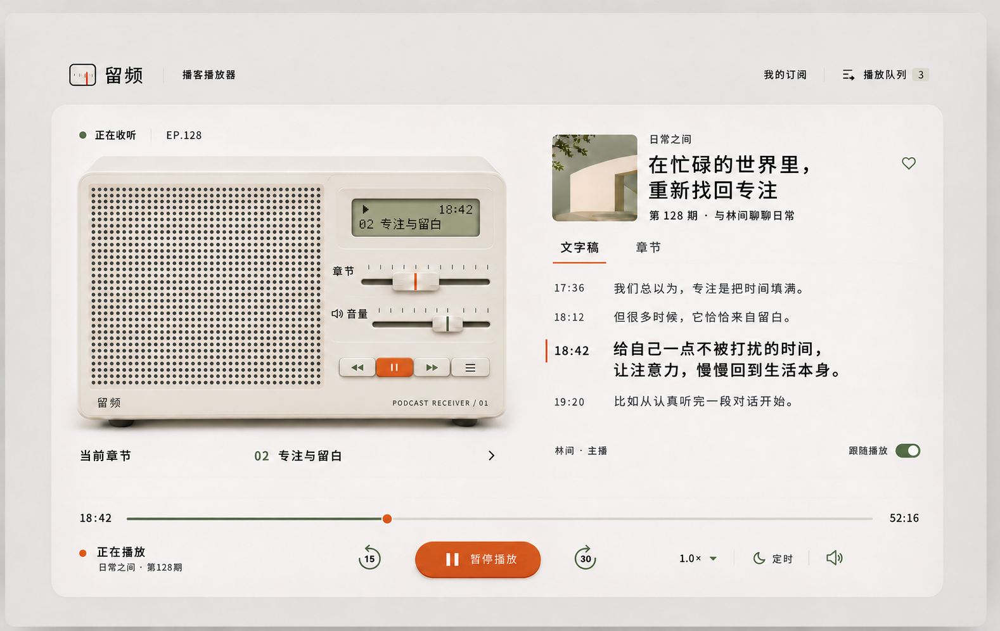
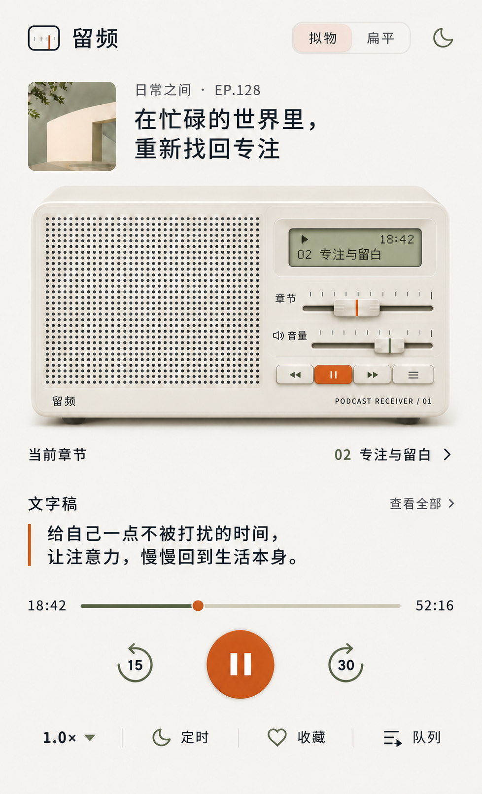

# 留频 · Stay Tuned 设计资料

归档日期：2026-11-14。来源：本次桌面端与手机端设计讨论及内置图像工具生成的静态参考稿。

## 从这里继续

后续在本项目中进行设计或 UI 实现时，以 [设计约束](constraints.md) 和下面两张最新参考图为基准。图片中的文字与装饰细节是参考；约束文档记录后续修改已覆盖的旧方案。

| 平台 | 当前基准 |
| --- | --- |
| 桌面端 · 亮色拟物 | [查看原图](references/current/desktop-light-skeuomorphic.png) |
| 手机端 · 亮色拟物 | [查看原图](references/current/mobile-light-skeuomorphic.png) |

### 桌面端



### 手机端



最新方案采用章节与音量双横向推杆、小型灰绿色反射式液晶屏。音量只通过滑块位置表达，屏幕内不再显示音量数字、百分比或条格。

## 版本优先级

1. 用户最新的明确要求。
2. `constraints.md` 中的已确认约束。
3. `references/current/` 中的最新参考图。
4. `references/explorations/` 中的历史探索图。

暗色、扁平以及早期移动端参考稿在双推杆和小液晶屏方案之前生成，尚未按最终硬件方案重绘。它们只用于理解配色、材质与布局方向，不能恢复旧旋钮、音量百分比、大型发光屏或把动态章节印在机身上的处理。

`../screenshots/` 为实现截图，与这里的目标设计参考分开保存。2026-11-14 已按双推杆与小屏方向完成桌面端和手机端实现，并把实现截图更新到 `../screenshots/`；参考图本身未改动。

## 资料结构

```text
docs/design/
├── README.md
├── constraints.md
├── manifest.json              原始文件名、用途、尺寸及 SHA-256
├── references/
│   ├── current/               最新基准：桌面端、手机端
│   └── explorations/          历史版本与明暗/扁平探索
└── prompts/                   原始生成提示词与当轮设计记录
```

所有图片均为原文件复制，不做裁切、拉伸或重编码。生成图的实际像素尺寸见 `manifest.json`；它们不是固定的 CSS 视口规格，手机端应按实际设备重排和验证。

## 历史探索索引

以下四组图片用于回溯外观方向，均早于最终双推杆与小屏设计。

| 平台与风格 | 亮色 | 暗色 |
| --- | --- | --- |
| 桌面 · 拟物 | [早期稿](references/explorations/liupin-light-skeuomorphic-v1.png) | [早期稿](references/explorations/liupin-dark-skeuomorphic-v1.png) |
| 桌面 · 扁平 | [早期稿](references/explorations/liupin-light-flat-v1.png) | [早期稿](references/explorations/liupin-dark-flat-v1.png) |
| 手机 · 拟物 | [早期稿](references/explorations/liupin-mobile-light-skeuomorphic-v1.png) | [早期稿](references/explorations/liupin-mobile-dark-skeuomorphic-v1.png) |
| 手机 · 扁平 | [早期稿](references/explorations/liupin-mobile-light-flat-v1.png) | [早期稿](references/explorations/liupin-mobile-dark-flat-v1.png) |

其余探索文件保留单推杆、双推杆和液晶屏迭代过程；使用原始文件名，逐项记录在 `manifest.json`。提示词是历史生成记录，其中被后续要求取代的指令不构成当前规范。

## 授权与素材来源

本目录中的设计参考图、提示词和实现截图由本项目为「留频」生成或整理，随项目按 **GPL-3.0-only** 发布；详见根目录 [NOTICE](../NOTICE) 与 [THIRD_PARTY_NOTICES.md](../../THIRD_PARTY_NOTICES.md)。

参考图中对 Braun / Dieter Rams 风格的提及仅用于设计说明，不代表关联、授权或背书；项目中不包含 Braun 产品或第三方商标素材。
